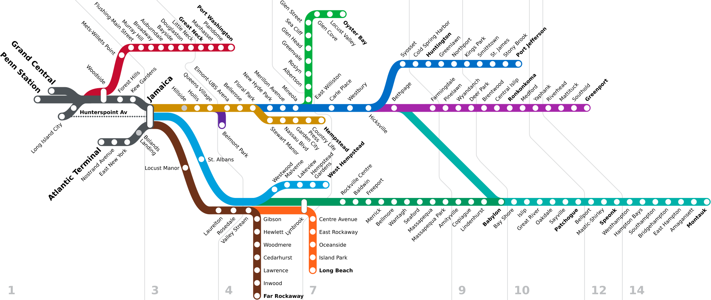
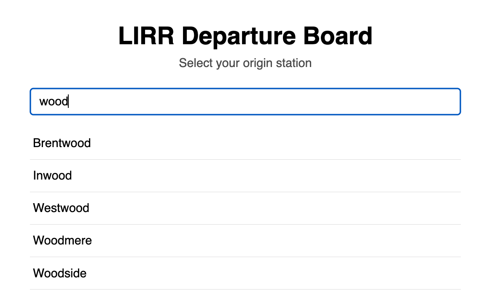
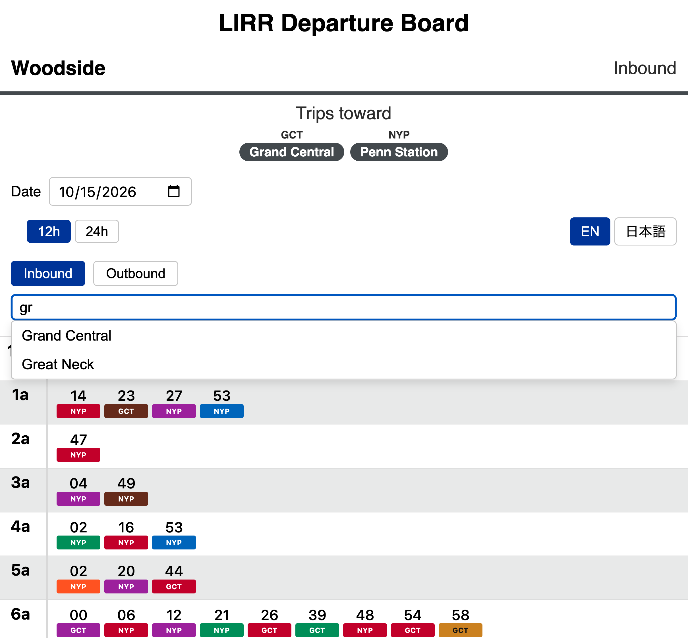
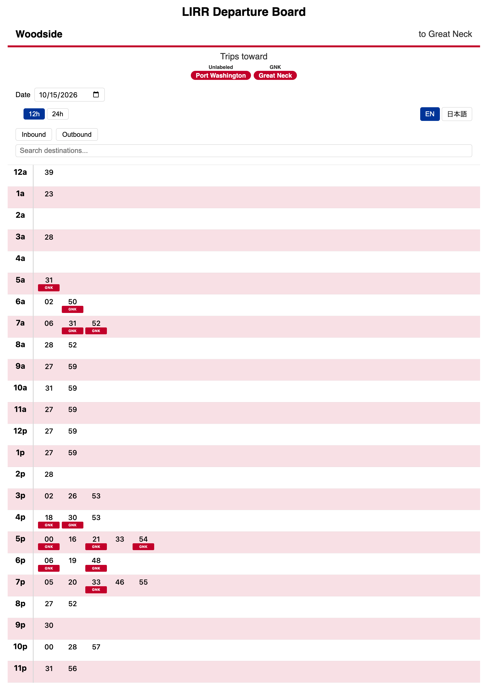
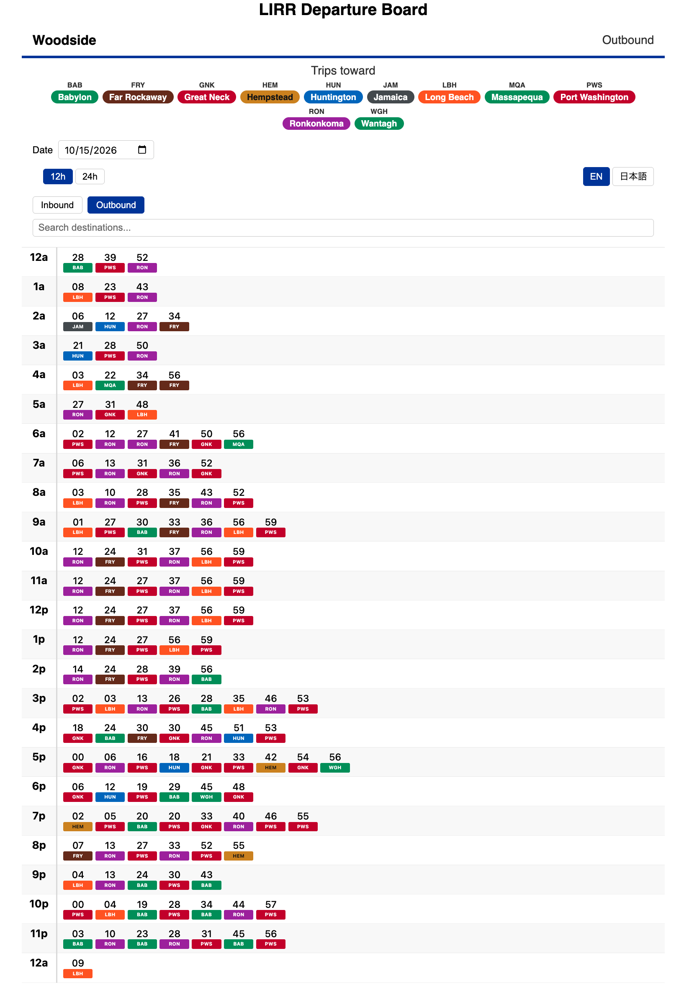

# Japanese-Style Timetables for the LIRR

## What the reader should take away

- It is possible to make timetables in this format, and I made one.
- They can use it to find trains that leave their desired station for a desired destination, or from their desired station inbound or outbound.
- This format is a potential and useful format for transit timetables outside Japan.

## Intro

- This post will be a departure from the usual blog topic of graph algorithms, to another network related topic: transit timetables.
- I have spent [some time] in Japan, and one thing that [verb]ed me is a format of timetable that i had never seen before
- image and caption of timetable.
- these timetables can be found at stations [preposition] many japanese railroad, metro, and bus systems
- I thought these were efficient and could be done for transit systems outside japan.
- The product of this [thought/idea] is a [web app](link) that generates departure timetables in this japanese format for all stations on the LIRR, the busiest commuter railroad in North America

<!-- Section goal: state the main point (the Japanese departure-timetable format works for a branching US commuter railroad), what I built, why, and the link. One sentence says the move away from graph algorithms is deliberate.

<https://bit.ly/lirrboard> -->

## Background

Section goal: show that the format is achievable for the LIRR despite its extra branching. Name the complication (Jamaica's 16 destinations on 9 branches); point to the two existing practices the board combines: Japanese destination marks with a legend, and the LIRR's written-out destinations with a color per branch.

### The Japanese format

I have interest in transit network

I've been to Japan

Japanese rail timetables are often presented in a format in which hours are shown on the left, and the minute of a train's departure during this hour is shown in a row to the right of the hour. Above or below this minute value, additional info may be shown such as whether the train is express, where it terminates, whether it has reserved seating, etc.

<!-- Include image of Japan timetable: nishi-ooi-weekday-cropped.png (JR East, Nishi-Ooi Station, weekday, with both legend rows). Optionally nishi-ooi-saturday-holiday-cropped.png (same station, Saturday and holiday, which adds a third legend row ■=時刻変更, schedule change). Caption for that image: "The same station's Saturday and holiday timetable. It adds a third legend row, 変更・注意マーク, where ■=時刻変更 flags a time that has changed; here it marks the 8:30 train." Credit under the image: JR East timetable, Nishi-Ooi Station, timetables.jreast.co.jp. Caption: "JR East's weekday timetable for Nishi-Ooi Station, southbound. A small mark under a minute shows where that train goes or what type it is. The legend at the bottom explains the marks: 無印=逗子 and 大=大船 for destinations, 無印=普通 and 快=快速 for train type." -->

Wanted to do this for LIRR

### The LIRR network and The problem: destinations

Japanese timetables also handle trains with different destinations. From Tokyo, the Chuo Line (Rapid) has 11 destinations on weekdays, but 8 of them lie along the Chuo Line itself; the rest are reached by trains continuing onto the Ome, Fujikyuko and Shinonoi lines. The LIRR branches far more: from Jamaica, trains go to 16 destinations on 8 major branches, most of which separate from the main line soon after Jamaica. So a timetable for the LIRR has to show where each train goes.

[^diagram]

 Credit under the image: JR East timetable, Tokyo Station, timetables.jreast.co.jp.

 

This branching situation necessitates a different kind of [symbology] from that typically used on Japanese timetables. The paradigm that the MTA uses is that branches are color-coded so that signage for destinations on a particular branch bears the color of that branch. In my departure timetable web app I follow the same [symbology] paradigm. This paradigm is shown in the overhead departure board which was removed from Penn Station in the early 2020s. ![the first train, a Port Washington branch train, terminates in Great Neck before reaching Port Washington. Another train with the same color later [moves] all the way to Port Washington. (Long Beach bears the Orange color which looks smiilar here. Similarly, a Ronkonkoma train will terminate in Ronkonkoma about 90 minutes after departure, where passengers can soon meet another Ronkonkoma branch train bound for Yaphank. Both of these are colored purple. (about 20 minuts after departure, the Ronkonkoma train will also have a timed transfer with the brown-coded Far Rockaway train at Jamaica ))](penn-station-lirr-board-2019-commons.jpg)

<!-- Include image of the LIRR's convention: penn-station-lirr-board-own-photo.jpg (my photo of the current digital departure board at Penn Station; each destination is written out on a bar colored by branch, and Huntington appears twice in the same blue). Also include penn-station-lirr-board-2019-commons.jpg (the older Solari board at Penn Station) for the shared-color point: Ronkonkoma and Yaphank share a color, two destinations on one branch.[^pennboard] -->

## Body: the board

Now, to using it.

After navigating to the website, you will get a screen asking for an origin station. Say you pick Woodside, a station in Western Queens about 10 minutes from Penn Station. Start typing Wood in the search bar and Woodside will appear. Or you can not type and scroll to W near the bottom of the page, since the stations are listed alphabetically. 

After you click on Woodside, the timetable will load. When it's loaded you can again use the search bar to search for destinations that are reachable from woodside. Let's try Great Neck

Recalling the pic before of the departure board featured overhead at Penn Station, you can see that most the departures from Woodside to Great Neck terminate either at Port Washington or Great Neck. The app is coded so that when a terminus makes up more than 2/3 of departures, it is left unmarked on the timetable. The header [indicates accordingly] that unlabeled departures terminate at Port Washington, while departures with a red indicator pill labeled `GNK` will terminate at Great Neck. And also just like the earlier overhead board, this board uses a red color scheme for the Port Washington branch destinations. Since this timetable deals only with Port Washington branch trains, most design elements [arealso red themed].

Keeping more with the spirit of the departure timetable, we can also click on the Outbound button to choose only outbound trains from Woodside. Like a typical Japanese departure timetable, this shows all trains departing from this station on a given day.

Here, the red accenting is gone, replaced with the rainbow of colors representing LIRR branches, and the blue color that is ubiquitous in MTA branding.

### How it's built

- OneBusAway server: built from OneBusAway's own Docker image, with a MySQL 8.4 database; it imports the GTFS bundle and answers schedule queries. The engine of this app, it was a convenient way for me to compile and query transit data without reinventing the wheel like I did with a pre-Claude Code iteration of this app in [2020](https://github.com/donovanrichardson/deparch-api).
- GTFS updater (Python): downloads the LIRR's GTFS feed from the MTA once a day, stages a new bundle for OneBusAway, and checks that every destination in the feed has an abbreviation.
- Transit board API (Java): a REST API between OneBusAway and the web page. It works out each trip's destination, the hour rows (including hours past 23), and sibling platforms.
- Front end (Svelte, served by nginx): the timetable grid, the pills, the destination filter, and the Japanese translation/transliteration.
- Monitor (Python): logs the host's CPU, memory and disk use and each container's resource use.
- All of it runs with Docker Compose, with a memory and CPU limit on each service.

## Final words

Many of the design decisions I made were particular to the LIRR situation. I first tried to make a departure timetable [app thing] that will be universal, but different sustems have different structures to their services, and riders may expectn certain features that are not generalizable to every network. Still I'd like to do this for other NYC-area commuuter rail services too. For now, try it at <https://bit.ly/lirrboard>. Feedback from LIRR commuters is welcome on my LinkedIn post about the board, <https://lnkd.in/p/gvgmEXC4>.

## Notes

[^branches]: East of Jamaica per Wikipedia's list, excluding the seasonal Belmont Park Branch and counting Babylon and Montauk as one line: Far Rockaway, Hempstead, Long Beach, Babylon/Montauk, Oyster Bay, Port Jefferson, Ronkonkoma, West Hempstead.
[^diagram]: Wikimedia Commons, File:LIRR_schematic.svg, public domain; schematic as of 2013, current version 2023 by ComplexRational, original by NE2. Credit is not required; give it anyway.
[^bug]: Git: 54d1120, 2026-09-11, transit-board#3. The commit also added a coverage check that flags missing abbreviations.
[^terminals]: Git: 2c100b8, 2026-09-11, check_headsign_coverage in the GTFS updater.
[^pennboard]: Wikimedia Commons, File:LIRR Train Info board in Penn Station New York.jpg, by Bonnachoven, uploaded 2019-02-01, CC0 1.0 (public domain); credit not required, give it anyway.
[^oba]: From the OneBusAway source: the bundle builder reads GTFS into a transit graph, an object graph of agencies, stops, trips, blocks and routes, serialized to disk as TransitGraph.obj, alongside block-based stop-time indices (BlockTripIndices.obj) and a spatial index (an STRtree) over stop locations. Sources: TransitGraphImpl and FederatedTransitDataBundle in onebusaway-application-modules. The docs only say "a series of files and optimized data structures".
