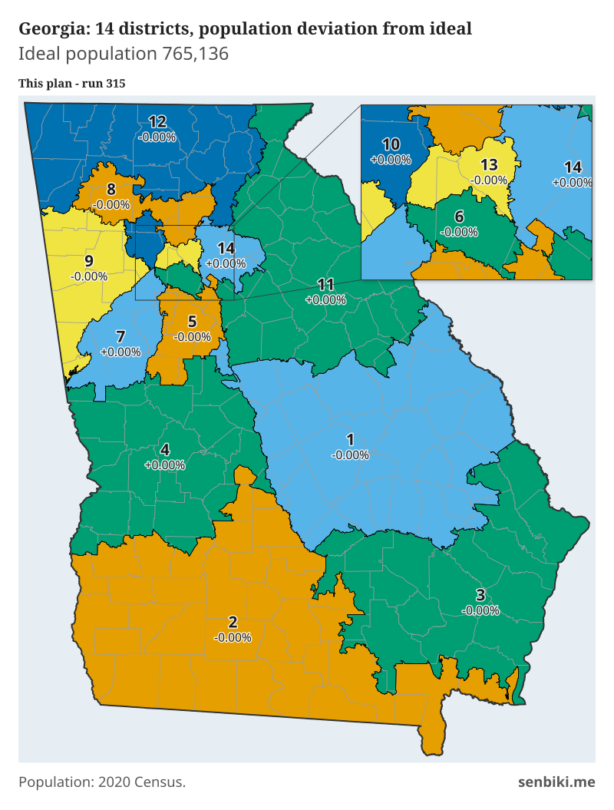
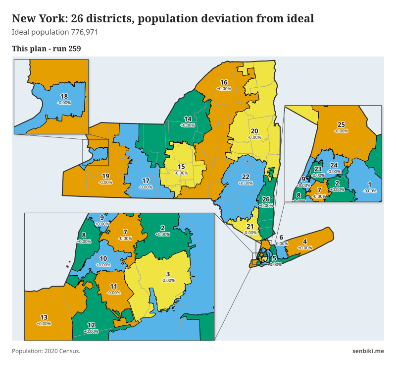

Some updates to the [redistricting post](/posts/redistricting/) I made a few months ago.

- Improved the algorithm so that district populations are closer to their exact population targets.
  - For now I have accomplished this by recursively dividing states into two subdistricts with the appropriate population, until districts with the target population size are created. Because the METIS algorithm does not achieve perfect balance between district populations, after each split I move or swap census tracts along the boundary between the two subdistricts, each time choosing the move that brings both sides closest to their target populations.
- Incorporated [Cook PVI-style](https://en.wikipedia.org/wiki/Cook_Partisan_Voting_Index#Calculation_and_format) partisanship ratings for the districts created by my algorithm.
  - The election results behind these ratings were obtained from the [Redistricting Data Hub](https://redistrictingdatahub.org/), which compiles data from the [Voting and Election Science Team (VEST)](https://dataverse.harvard.edu/dataverse/electionscience). Its [terms of use](https://redistrictingdatahub.org/terms-and-conditions/) require that the data be used only "for noncommercial, nonpartisan purposes and not for gerrymandering." The PVI ratings are calculated after the districts are drawn. Election results are never an input to the algorithm.

## Case study: Texas

Many state legislatures have employed "packing", which is the practice of collecting areas with strong partisanship into a small number of districts for the purpose of minimizing the influence of that partisanship in neighboring districts. Lawmakers also target regions dominated by one party by dividing them among many districts that are dominated by the other party in a process called "cracking". Legislatures often create cracked and packed districts to magnify the overall partisan leaning of their elections.

The case of Texas shows this effectively. Many of Texas' districts are packed and cracked. 30 of Texas' 38 congressional districts lean Republican based on the last two presidential elections[^pvi], making up 79% of Texas' congressional representation. Yet only 56% of votes in Texas were for the Republican candidate in the 2024 election, and 52% in the 2020 election. Some of this effect is due to Democratic voters being more geographically concentrated in the state than Republican voters. But around Texas' principal cities there are congressional districts that form recognizable gerrymanders stretching from reliably Republican areas far away to these cities' Democratic-leaning suburbs, in a classic cracking pattern.

![Two maps of Texas side by side, colored on a red-to-blue scale by partisan lean. On the left, the current map has 30 red districts and 8 blue ones; the blue districts are small, mostly dark blue, and confined to the cores of Houston, Dallas, Austin, San Antonio and El Paso, while most red districts are a similar medium red (R+7 to R+13). On the right, the algorithm's map has 21 red districts, 14 blue districts and 3 near-white even districts, with each metro area divided into several compact districts of varying shades. Zoomed insets enlarge the densest areas on both maps.](texas_pvi_run299_run311_simplified.svg)

*Texas partisan lean by district. Left: the current map (120th Congress), 30 R, 8 D. Right: my algorithm's map, 21 R, 3 EVEN, 14 D. Cook-style PVI, 75% 2024 and 25% 2020. Data: Redistricting Data Hub and VEST.*

Because my redistricting algorithm avoids drawing district boundaries that unnecessarily split population centers, the resulting districts are more compact and tend to be anchored by central cities and towns. These hypothetical districts more accurately represent the political partisanship existing in various coherent regions of Texas, rather than creating contrived constituencies for the sake of partisan advantage. As a result of basing district boundaries on geographical principles instead of partisanship, 21 of the 38 districts output from my algorithm favor Republicans and 14 favor Democrats. The other 3 districts are evenly split. This makes 55% of districts clearly in favor of Republicans, which is much more in line with Texas' overall partisanship.

Using this same algorithm, hypothetical congressional districts and other equal-population divisions can be created for any state or jurisdiction in the United States.

## Gallery

### Massachusetts

*Massachusetts, 9 districts drawn by the algorithm. Every district is within 9 people of the ideal population of 781,102. Population: 2020 Census.*

*Massachusetts partisan lean. Left: the current map, 9 D. Right: my algorithm's map, also 9 D. Data: Redistricting Data Hub and VEST.*

### Georgia

*Georgia, 14 districts drawn by the algorithm. Every district is within 12 people of the ideal population of 765,136. Population: 2020 Census.*

*Georgia partisan lean. Left: the current map, 9 R, 5 D. Right: my algorithm's map, 9 R, 1 EVEN, 4 D. Data: Redistricting Data Hub and VEST.*

### New York

*New York, 26 districts drawn by the algorithm. Every district is within 28 people of the ideal population of 776,971. Population: 2020 Census.*

*New York partisan lean. Left: the current map, 19 D, 1 EVEN, 6 R. Right: my algorithm's map, 16 D, 10 R. Data: Redistricting Data Hub and VEST.*

[^pvi]: Partisan lean is measured with a Partisan Voter Index (PVI) calculated the same way as the [Cook Political Report's Cook PVI](https://www.cookpolitical.com/cook-pvi). A district's PVI is its share of the two-party presidential vote, weighted 75% for 2024 and 25% for 2020, compared with the same figure for the nation as a whole. For example, R+5 means the district voted 5 points more Republican than the nation. Districts within half a point of the nation are labeled EVEN. These figures are my own calculations from Redistricting Data Hub data, not Cook's published ratings.
